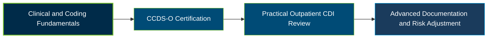

# ACDIS CCDS-O Certification Exam Guide

[](https://acdis.org/certification/ccds-o)
[](https://acdis.org/certification/ccds-o)

A dedicated, comprehensive study guide and clinical documentation reference repository for candidates preparing for the **Certified Clinical Documentation Specialist-Outpatient (CCDS-O) Certification Exam**.

---

## Exam Overview

The ACDIS CCDS-O Certification validates outpatient clinical documentation integrity (CDI) knowledge, including medical record review, coding and reimbursement requirements, risk adjustment, and compliant documentation practices.

- **Exam Format**: Computer-based, multiple-choice examination administered through Prometric testing centers or remote proctoring.
- **Target Audience**: Outpatient Clinical Documentation Specialists, Registered Nurses, Physicians, Health Information Management Professionals, and Medical Coding Specialists.
- **Prerequisites**: Candidates must hold a qualifying credential (RN, MD, DO, RHIA, RHIT, CCS, CPC, CRC, or COC) and meet one of the experience pathways: two years in outpatient CDI, or one year each in inpatient and outpatient CDI, using U.S. reimbursement systems.

---

## Core Exam Domains & Knowledge Areas

### 1. Healthcare Regulations, Reimbursement, and Documentation Requirements

- Apply Official Guidelines for Coding and Reporting to outpatient documentation and diagnosis selection.
- Understand the Outpatient Prospective Payment System (OPPS), reimbursement, and provider coding and billing.
- Recognize documentation requirements affecting medical necessity, claims, and payment.

### 2. Diseases and Disease Processes

- Interpret clinical indicators and disease processes during outpatient medical record review.
- Recognize documentation clarification opportunities involving common conditions and abnormal findings.
- Connect clinical evidence, diagnostic information, and treatment details to accurate documentation.

### 3. Risk Adjustment Models and Clinical Chart Review

- Understand risk adjustment methodologies and the CMS-HCC model, including Version 28.
- Evaluate how clinical documentation and code assignment affect risk scores and reimbursement.
- Identify documentation gaps that may affect accurate risk adjustment.

### 4. CDI Program Concepts, Metrics, and Provider Education

- Understand CDI program metrics, performance monitoring, and provider response trends.
- Develop compliant provider education and documentation clarification practices.
- Communicate effectively with providers to improve documentation quality.

### 5. Quality, Regulatory, and Health Initiatives

- Understand healthcare quality programs and regulatory requirements relevant to outpatient CDI.
- Recognize how documentation and coding affect quality reporting and compliance.
- Apply ethical practices and compliant query guidance to outpatient documentation scenarios.

---

## Certification Path

The following diagram illustrates a suggested learning progression, not an official ACDIS certification pathway.



---

## Recommended Practice & Study Resources

To prepare effectively, combine official ACDIS materials with current coding guidance and practical outpatient documentation review.

- **CertsGate**: Explore [CCDS-O certification preparation resources](https://certsgate.com/exams/acdis/ccds-o) for supplementary study materials and practice questions covering outpatient CDI, coding, and risk adjustment.
- **Practical Study Resource**: Consult the [CMS ICD-10-CM Official Guidelines for Coding and Reporting](https://www.cms.gov/medicare/coding-billing/icd-10-codes) and apply the guidelines to hypothetical outpatient documentation and compliant query scenarios.
```
